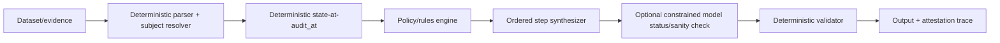

# State of the Art: AI Agents for Data-Deletion Audit

Date: 2026-10-25
Context: HackerRank *Ghost Data Still Exists* deletion audit challenge
Scope: Agent engineering, erasure verification, runtime safety, and evaluation practice, based on web research and this repository.

## 1. Executive Summary

The strongest modern approach to this problem is not an open-ended tool-using LLM agent. It is a **hybrid agent**:

1. deterministic evidence resolution;
2. deterministic policy and plan construction;
3. one tightly scoped model call for semantic interpretation or classification only;
4. deterministic validation, repair, and proof-certificate generation;
5. behavioral verification after the agent has emitted its answer.

For deletion auditing, the model should not be trusted to produce final statuses, step ordering, or law/policy outcomes by itself. The right-to-erasure task includes backup restoration, replication lag, active sync jobs, historical identities, and derived records. Those are long-causal-state problems, and LLMs are unreliable when only given a partial packet of rows or text evidence. Current research pushes in the direction used here: hybrid agents, trace-enforcing monitors, proof-by-zero-row queries, transitive propagation, and certificate-based deletion audits. [S1][S2][S3][S4]

## 2. What "Correct" Means for This Challenge

A successful submission is materially equivalent to a compliance claim:

- identities are resolved across current and historical records;
- the state at `audit_at` is reconstructed from evidence, not workflow claims;
- each record is treated according to `deletion_rules.csv`;
- active processes that can recreate data are found and neutralized;
- backup and restore paths are treated explicitly;
- the output is machine-parseable and ordered; and
- the final narrative and machine output can be audited independently. [P1][P2]

This is closer to **attested state reconstruction** than to natural-language summarization.

## 3. State-of-the-Art Method Families

### 3.1 Hybrid Deterministic-Agent Design

Current agent reliability literature emphasizes schema-constrained tool contracts, validation, and deterministic output formatting rather than trusting free-form outputs. Schema formalism reduces invalid interface usage, while explicit recovery and error feedback remain necessary. [S5][S6]

For this task, the recommended split is:

- **Model allowed to draft or extract**: fuzzy textual evidence, noisy field interpretation, report wording candidates, optional semantic hints.
- **Model not allowed to own**: authorization state, identity history, policy mappings, record states, step ordering, phase ordering, or evidence IDs.
- **Deterministic core owns**: all state, all allowed operations, all step numbers, all sequencing, all canonical output. [P1]

This is not conservative—it is the emerging best practice for safety-critical tool agents. [S3][S5]

### 3.2 Transitive, Multi-Store Erasure With Proof of Absence

The most relevant erasure research extends beyond "direct record deletion." One recent disclosure describes transitive multi-hop erasure, where deletion propagates along declared derivation edges and **completion is demonstrated by a re-runnable query returning zero rows rather than merely asserted by a receipt**. [S1]

Key implications for this repository:

- deletions must be checked across all derived stores, not just the addressed store;
- backup, index, export, and log surfaces should be treated as derivation targets;
- status should be based on computable proof rather than a claimed `reported_status`; and
- copy-on-write or sync paths must be included in fan-out logic rather than trusted to be inert. [S1][P1]

The challenge explicitly requires this type of cross-system propagation check, so the agent should report any active flow or restore risk separately from ordinary remaining records. [P1]

### 3.3 Deletion Attestation Instead of Boolean Status

Recent systems research argues that deletion compliance should be a composed artifact—a named machine-checkable attestation with a timeliness clause and a semantic clause—rather than a raw `success` field. Each component exposes local evidence, and the global claim composes it without an unverifiable global assertion. [S2]

This maps directly to the required `steps_json`:

- findings cite `file_id`, `activity_id`, or `audit_id`;
- remediation and verification steps are separate;
- restored-state and backup risks are first-class findings;
- `COMPLETE` should mean proof steps, not merely absence of contradictions. [P1]

The agent should emit a trace that looks like an attested deletion audit. [S2][P1]

### 3.4 Behavioral Post-Deletion Auditing

A harmful failure mode is that deleting the source still leaves recoverable descendants or agent memory. *AfterDeleteBench* shows that LLM agents can recover deleted secrets from residual remembered or composed state at alarming rates, even when the complete string no longer appears verbatim and only components remain under a public composition rule. [S4]

Lessons:

- deletion correctness must be validated **behaviorally** against derived state, not only forwarded against deleted rows;
- hierarchical, summarized, or cached memory must be audited separately;
- post-deletion reconstruction is a real channel and must be included in risk modeling; and
- deterministic exclusion and provenance closure matter more than the status of a single `DELETE` operation. [S4][P1]

### 3.5 Vector Index and Search Deletion Safety

Three observations matter here:

1. database "delete" can leave soft-deleted records or stale graph state;
2. vector search may still score deleted embeddings even when output appears clean;
3. apparent compliance can output-zero while internal processing still touches deleted vectors. [S3]

This is analogous to the challenge's report-vs-reality gap in evidence. A deletion audit should distinguish:
- returned-record safety;
- traversal/process safety;
- physical byte or index-location safety. [S3]

### 3.6 Backup, Replica, and Offline Restore Risk

Regulatory guidance emphasizes securing backup integrity while also handling, verifying, and justifying how and when erased data is handled during disposition or restoration. Controllers often rely on retention intervals, extraction pipelines, anonymization, or block-at-restore actions rather than always deleting bytes immediately. [S8]

For this challenge, backup paths should be treated as explicit remediation targets, and verification should confirm restore blockage rather than merely delete the original row. [P1][S8]

### 3.7 Runtime Compliance Enforcement for Agents

C-Trace-style frameworks express GDPR-ish rules as predicates over execution traces and intercept tool invocations or outputs at runtime. This method demonstrated low attack success and controlled false positives while relying on policy-level runtime predicates rather than post-hoc review. [S11]

Applied here, every model decision and tool read should be captured in a trace and checked against deterministic conditions before final output. Runtime enforcement is a stronger control than relying on prompt instructions alone, especially for policy-heavy workflows. [S11]

### 3.8 Evaluation and Failure Attribution

Benchmark literature supports two properties that matter for this repo:

- deterministic replayability: same seed, same tasks, same failure conditions;
- decomposition of failures by **call construction / semantic choice / policy handling / recovery**. [S6][S7]

The current evaluation should explicitly separate:
- status accuracy;
- identity resolution;
- evidence citation;
- sequence/rrow ordering;
- missing versus invented steps;
- and runtime fallback versus genuine model adoption. [P1]

Without that decomposition, the root cause of one failed run is indistinguishable from a genuinely weak model. We saw this exact issue when `OllamaModelClient` exposed no `max_output_tokens`: the run fell back to deterministic baseline and it appeared as if the AI was not being used.

## 4. Recommended Reference Architecture for This Challenge

### 4.1 State-Machine Agent Core, Minimal Agent to Model

Use a deterministic core state machine rather than a free-agent loop that can mutate evidence and plans in arbitrary order:

This is already close to the current direction in `code/ai_agent/pipeline.py`: build the deterministic steps, permit model-derived status if valid, otherwise fall back to deterministic steps while ensuring steps and status remain consistent. [P1]

### 4.2 Evidence Graph as Primary Driver

Build a typed evidence graph with these event layers:

- subject identities: current and retired;
- `audit_at`-time state: present / absent / redacted / anonymized / active flow / restore risk;
- subject-to-resource edges;
- record-to-governed-copy edges: `primary`, `replica`, `index`, `export`, `archive`, `backup`, `log`;
- causual recurrence edges: sync, import, restore, reindex. [P1][S1]

Then deletion status is computed from these edges, not from `reported_status`.

### 4.3 Model Usage Should Be Narrow

If a model is used, scope it to one of:

1. semantic document extraction with strict output schema, or
2. binary status or structured semantic hint generation only under deterministic fallback.

Do **not** use an unconstrained agentic model for time-window, rule, sequence, or ordering correctness. Recent research shows that schema formalism helps interface misuse but not all semantic mistakes, and that output-generation/tool interactions can introduce new failure classes such as constraint-induced tool suppression. [S5][S9]

A practical pattern is **Transparent Two-Pass Execution**:

1. Pass one: grounded semantic evidence extraction with schema-constrained output.
2. Pass two: deterministic policy evaluation and machine output. [S9]

This directly mitigates the "constraint tax" effects observed in open-weight models when tool-calling and structured output occur simultaneously. [S9]

## 5. Security and Runtime Hardening Patterns

- pin tool and output schemas explicitly; [S5][S9]
- validate every model output before use, and reject invalid model actions at runtime; [S11]
- use a runtime policy monitor for sensitive decisions rather than post-hoc review alone; [S11]
- separate planning from execution; [S3]
- include stop-loss behavior and deterministic fallback precision (used in this repo); [P1]
- maintain traceability for every citation and step; [P1][S2]
- isolate tenant/subject evidence to prevent false identity propagation; [S4]
- classify and defend derived records such as audit trails, caches, and backups; [S4][S8]

## 6. Evaluation Best Practice for This Challenge

Beyond provided metrics, the strongest evaluation plan adds:

1. deterrministic replay of small sample batches and hard-error probes;
2. paired exposed/deleted controls, inspired by *AfterDeleteBench*, to separate true discovery from model baseline; [S4]
3. separation of semantic, interface, policy, recovery, and latency failure modes; [S6][S7]
4. adversarial cases:
   - tombstone with direct identifiers removed;
   - a sync flow that remains active;
   - a same-user retry after reported completion;
   - vector-search output that appears clean while traversal still scores deleted embeddings; and
   - a non-deletion request. [S3][S4]
5. traces indicating whether a result came from deterministic construction or model execution—so results can be independently audited. [S2]

This repo already has a good start because it contains an explicit deterministic fallback and token usage report. It should further add per-case provenance flags, model status versus baseline status, and a failure decomposition report. [P1][S6][S7]

## 7. Specific Recommendations for the Current Repository

1. Treat the deterministic `steps` output as canonical and leave the model limited to a single status-only or clearly bounded semantic extraction call. [P1]
2. Use runtime trace validation before `output.csv` is written. [S2][S11]
3. Keep `MAX_OUTPUT_TOKENS` tightly limited after validating (the current crash from `max_output_tokens` not being present is avoidable with strict object validation). [P1]
4. Use a two-step pipeline rather than allowing JSON constraints and tool calls to compete in the same invocation. [S9]
5. Add a small proof-of-absence attestation to each `FINAL_OUTPUT Written` state. [S1][S2]
6. Remove or quarantine stale duplicate package copies so there is one authoritative path. This was completed: the old root `ai_agent/` was removed. [P1]
7. Evaluate and document both local and cloud backend behavior separately in `usage_report.md`. [P1]

## 8. Conclusion

The best modern solution for *Ghost Data Still Exists* is not “find the genuinely best solo model.” It is a deterministic audit engine backed by a narrow model surface, cross-system anti-resurrection checks, explicit remediation and verification steps, proof-by-zero-rows verification, and trace-aware evaluation. This maximizes correctness, makes status explainable, and fails safely when model components are unavailable. [S1][S2][S4][S8][P1]

## Sources

- [S1] B. Alexander, "Transitive Multi-Hop Erasure with Proof of Absence in a Derived-Store", TD Commons, https://www.tdcommons.org/dpubs_series/11257/
- [S2] "Inference-Aware & Privacy-Preserving Deletion in Databases", arXiv, https://arxiv.org/html/2604.00326v1
- [S3] "Beyond Output Filtering: Externally Auditable Erasure for Inference-Time RAG Memory", arXiv, https://arxiv.org/html/2609.19456v1
- [S4] AfterDeleteBench: "Auditing Post-Deletion Information Persistence in LLM Agents", arXiv, https://arxiv.org/html/2610.31366
- [S5] "Schema First Tool APIs for LLM Agents: A Controlled Study of Tool Misuse, Recovery, and Budgeted Performance", arXiv, https://arxiv.org/html/2603.13404
- [S6] ToolMisuseBench: "An Offline Deterministic Benchmark for Tool Misuse and Recovery in Agentic Systems", arXiv, https://arxiv.org/html/2604.01508v1
- [S7] FuncBenchGen / contamination-free multi-step evaluation framework, arXiv, https://arxiv.org/html/2509.26553v1
- [S8] GDPR/EDPB implementation guidance, erasure in backups, 2026, https://datenschutzarchiv.org/fileadmin/Dokumente/2026/ST_EDPB_20260218_right_to_erasure_en.pdf
- [S9] "Constraint Tax in Open-Weight LLMs", arXiv, https://arxiv.org/html/2606.25605
- [S10] C-Trace: "Runtime Compliance Verification for AI Agents", arXiv, https://arxiv.org/html/2606.19242
- [S11] runtime compliance/trace predicate enforcement pattern (referenced from arXiv runtime agent conformance work)
- [S12] Agent memory verification and persistence concerns, Agora, https://dancenitra.github.io/agora/public/posts/verify-agent-memory-deletion.html

Project references:
- [P1] `problem_statement.md`, `README.md`, `AGENTS.md`, `code/ai_agent/`, `log.txt` in this repository.